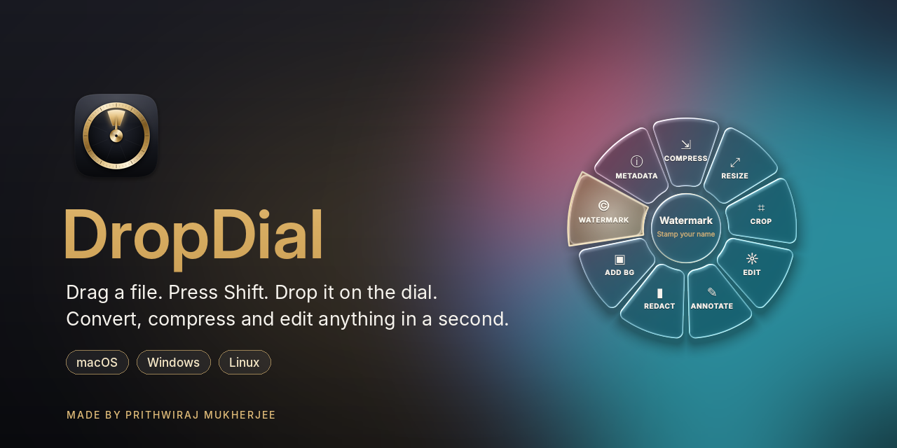
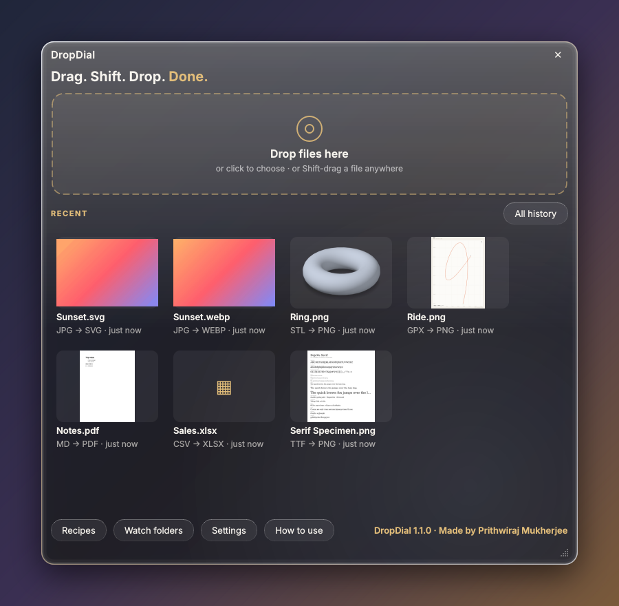
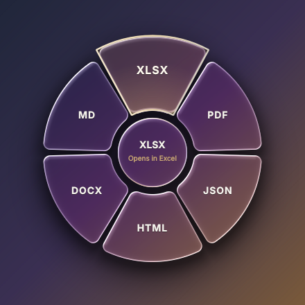

<p align="center">
  
</p>

<p align="center">
  <b>Ein kostenloser Open-Source-Dateikonverter, den du per Drag-and-drop bedienst.</b><br>
  Zieh eine beliebige Datei, drück <kbd>Shift</kbd> und leg sie auf einem Segment des gläsernen Drehrads ab, das sich an deinem Mauszeiger öffnet.
</p>

<p align="center">
  <a href="https://github.com/prithwirajmukherjee15-cmd/DropDial/releases/latest"><b>Download</b></a> ·
  <a href="#installation">Installation</a> ·
  <a href="#erster-start">Erster Start</a> ·
  <a href="#formate">Formate</a> ·
  <a href="#kommandozeile">Kommandozeile</a> ·
  <a href="#entwicklung">Entwicklung</a>
</p>

<p align="center">
  <a href="https://github.com/prithwirajmukherjee15-cmd/DropDial/actions/workflows/ci.yml"></a>
  <a href="https://github.com/prithwirajmukherjee15-cmd/DropDial/releases/latest"></a>
  <a href="https://github.com/prithwirajmukherjee15-cmd/DropDial/releases"></a>
  
  
  
  <a href="LICENSE"></a>
</p>

<p align="center"><a href="README.md">English</a> · <a href="README.hi.md">हिन्दी</a> · <a href="README.es.md">Español</a> · <a href="README.fr.md">Français</a> · <b>Deutsch</b> · <a href="README.pt-BR.md">Português (Brasil)</a> · <a href="README.ja.md">日本語</a> · <a href="README.ko.md">한국어</a> · <a href="README.zh-CN.md">简体中文</a> · <a href="README.ru.md">Русский</a> · <a href="README.ar.md">العربية</a></p>

<p align="center">
  <a href="https://github.com/prithwirajmukherjee15-cmd/DropDial/releases/latest/download/DropDial-mac-apple-silicon.dmg"></a>
  <a href="https://github.com/prithwirajmukherjee15-cmd/DropDial/releases/latest/download/DropDial-mac-intel.dmg"></a>
  <br>
  <a href="https://github.com/prithwirajmukherjee15-cmd/DropDial/releases/latest/download/DropDial-Setup.exe"></a>
  <a href="https://github.com/prithwirajmukherjee15-cmd/DropDial/releases/latest/download/DropDial-linux-amd64.deb"></a>
</p>

> [!IMPORTANT]
> **Du öffnest DropDial zum ersten Mal?** Windows und macOS zeigen einmalig eine Sicherheitswarnung, weil die App noch nicht code-signiert ist. Sie ist sicher, und in 10 Sekunden bist du an der Warnung vorbei. **[Siehe Erster Start ↓](#erster-start)**

<table>
  <tr>
    <td width="33%" valign="top"><b>Direkt am Mauszeiger</b><br>Kein App-Fenster, das du öffnen musst. Das Drehrad erscheint dort, wo du gerade bist, und zeigt nur die Formate, die zu den gezogenen Dateien passen.</td>
    <td width="33%" valign="top"><b>Über 140 Dateitypen, keine weitere Software</b><br>Bilder, Kamera-RAW, PDF, Word, Excel, E-Books, Video, Audio, Untertitel, Archive, Schriften, 3D-Modelle und Kartendateien funktionieren ohne Office oder sonst irgendetwas Installiertes.</td>
    <td width="33%" valign="top"><b>Bleibt auf deinem Computer</b><br>Nichts wird hochgeladen. DropDial arbeitet offline und speichert das Ergebnis neben dem Original, niemals darüber.</td>
  </tr>
</table>

## So sieht es aus

<p align="center">
  
</p>

## Installation

Lade DropDial unter [Releases](https://github.com/prithwirajmukherjee15-cmd/DropDial/releases/latest) herunter.

- **macOS 11+**: Öffne die `.dmg` ([Apple Silicon](https://github.com/prithwirajmukherjee15-cmd/DropDial/releases/latest/download/DropDial-mac-apple-silicon.dmg) · [Intel](https://github.com/prithwirajmukherjee15-cmd/DropDial/releases/latest/download/DropDial-mac-intel.dmg)) und zieh DropDial in den Ordner „Programme“. Oder füge das hier im Terminal ein: Es wählt den passenden Build, installiert ihn ohne Sicherheitsabfrage und aktualisiert ihn, wenn du es erneut ausführst:
  ```bash
  curl -fsSL https://raw.githubusercontent.com/prithwirajmukherjee15-cmd/DropDial/main/install-mac.sh | bash
  ```
- **Windows 10/11**: Führe [`DropDial-Setup.exe`](https://github.com/prithwirajmukherjee15-cmd/DropDial/releases/latest/download/DropDial-Setup.exe) aus (installiert für deinen Benutzer, ohne Administratorrechte; fügt das Kontextmenü, *Senden an* und den Autostart mit Windows hinzu), oder nutze die portable [`DropDial.exe`](https://github.com/prithwirajmukherjee15-cmd/DropDial/releases/latest/download/DropDial.exe).
- **Linux x64** (Debian 12+, Ubuntu 23.04+, Mint…): `sudo apt install ./DropDial-linux-amd64.deb` ([Download](https://github.com/prithwirajmukherjee15-cmd/DropDial/releases/latest/download/DropDial-linux-amd64.deb)). Die Shift-Geste braucht X11; unter Wayland nutzt du die Ablagefläche in Home oder Rechtsklick → **Öffnen mit → DropDial**.
- **Linux ARM64** (Ubuntu 24.04+, Debian 13+, Raspberry Pi OS 13 64-Bit …): `sudo apt install ./DropDial-linux-arm64.deb` ([Download](https://github.com/prithwirajmukherjee15-cmd/DropDial/releases/latest/download/DropDial-linux-arm64.deb)).

DropDial wohnt in der Menüleiste / im Infobereich der Taskleiste und sagt dir Bescheid, wenn eine neue Version erscheint.

## Erster Start

DropDial ist noch nicht code-signiert (Signaturzertifikate kosten jedes Jahr Geld), deshalb zeigen Windows und macOS **nur beim ersten Mal** eine Warnung. Der gesamte Code von DropDial ist in diesem Repository öffentlich, und die Downloads werden automatisch von GitHub daraus gebaut.

### Windows: „Der Computer wurde durch Windows geschützt“

SmartScreen zeigt diese Meldung eventuell, wenn du `DropDial-Setup.exe` oder `DropDial.exe` zum ersten Mal startest.

1. Klicke auf **Weitere Informationen**.
2. Klicke auf **Trotzdem ausführen**.

Das war’s. Windows fragt nicht noch einmal.

### Mac: „Apple konnte nicht überprüfen, ob DropDial …“

Wenn du mit der Terminal-Zeile oben installiert hast, kannst du diesen Abschnitt überspringen: Es erscheint keine Warnung. Bei der **.dmg** meldet macOS *„Apple konnte nicht überprüfen, ob „DropDial“ frei von Schadsoftware ist, die deinem Mac schaden oder deine Privatsphäre gefährden kann.“* Das sagt macOS über jede App, die nicht Apples kostenpflichtige Beglaubigung (Notarisierung) durchlaufen hat. So öffnest du sie:

1. Öffne **DropDial** einmal aus dem Ordner „Programme“ und klicke in der Warnung auf **Fertig**.
2. Öffne **Apple-Menü → Systemeinstellungen → Datenschutz & Sicherheit**. Scrolle nach unten zu **„DropDial“ wurde blockiert, um deinen Mac zu schützen.** und klicke auf **Trotzdem öffnen**.
3. Gib dein Passwort ein und klicke zur Bestätigung noch einmal auf **Trotzdem öffnen**.

Fertig. macOS merkt sich die Entscheidung, du musst das also nur einmal machen.

<details>
<summary>Lieber im Terminal? Ein Befehl erledigt dasselbe</summary>

```bash
xattr -dr com.apple.quarantine /Applications/DropDial.app
```

Öffne DropDial danach ganz normal.
</details>

> [!NOTE]
> Ab macOS 15 (Sequoia) kommst du mit dem alten Trick **Rechtsklick → Öffnen** nicht mehr an dieser Warnung vorbei. Nutze die Schritte oben.

### Mac, optional: Bildschirmaufnahme

DropDial fragt eventuell nach der Berechtigung für **Bildschirmaufnahme**. Erlaubst du sie, zeigt das gläserne Drehrad die Fenster dahinter. Erlaubst du sie nicht, funktioniert trotzdem alles, und das Glas zeigt stattdessen deinen Schreibtischhintergrund. **Es wird niemals etwas aufgenommen, gespeichert oder irgendwohin gesendet.** Du kannst das jederzeit unter **Systemeinstellungen → Datenschutz & Sicherheit → Bildschirm- & Systemaudioaufnahme** ändern.

## Funktionen

- **Ein Drehrad am Mauszeiger**: Dateien ziehen, <kbd>Shift</kbd> drücken, auf einem Format ablegen. Es erscheinen nur Formate, die zu den Dateien passen.
- **Mehr als eine Seite**: Tippe erneut auf <kbd>Shift</kbd>, drück <kbd>Tab</kbd> oder dreh am Mausrad, um zu **More formats**, **Tools** und **Recipes** umzublättern.
- **Direkt aus dem Browser**: Zieh ein Bild, einen Link auf eine Datei oder einen Download aus Chrome, Edge, Firefox oder Safari. DropDial speichert ihn unter „Downloads“ und konvertiert ihn dann.
- **Home**: Klicke auf das Symbol im Infobereich / in der Menüleiste für eine Ablagefläche (ohne Shift) und deine letzten Ergebnisse mit Vorschau. Öffnen, im Ordner zeigen, erneut konvertieren oder rückgängig machen.
- **Werkzeuge für jede Dateiart**: Bilder komprimieren, skalieren, zuschneiden, bearbeiten, beschriften, schwärzen, mit Wasserzeichen versehen und von Metadaten befreien; PDFs teilen, zusammenführen, drehen, nummerieren, schützen, entsperren und komprimieren; Videos komprimieren, stummschalten und drehen; Audio normalisieren; Untertitel bereinigen; Schriften auf Teilmengen reduzieren; 3D-Modelle reparieren; Tourstatistiken für GPS-Tracks; und mehr.
- **Recipes**: Verkette mehrere Schritte in einem Segment („Web-ready“, „Email size“, „Private“ …) oder bau dir eigene.
- **Überwachte Ordner** konvertieren jede Datei, die darin landet.
- **Viele Dateien auf einmal**, ein ZIP-Segment für einen Stapel Dateien oder einen Ordner und **History**, um alles wiederzufinden oder rückgängig zu machen.
- **Weitere Wege**: das Kontextmenü, *Senden an* (Windows), die Ablagefläche in Home und der [Befehl `dropdial`](#kommandozeile).
- **Dein Look**: Drehrad aus flüssigem Glas mit einer Akzentfarbe deiner Wahl (Champagne, Rose, Ocean, Emerald, Violet, Silver).

## Screenshots

<table>
  <tr>
    <td width="58%"></td>
    <td width="42%"></td>
  </tr>
  <tr>
    <td align="center"><sub>Home: Ablagefläche und letzte Ergebnisse (ein 3D-Render, eine GPS-Karte, ein Schriftmuster …)</sub></td>
    <td align="center"><sub>Das Drehrad für eine Tabelle; umdrehen für More formats und Tools</sub></td>
  </tr>
</table>

## Formate

| Von | Nach |
|---|---|
| **Bilder**: JPG, PNG, WEBP, HEIC, AVIF, TIFF, GIF, BMP, ICO | untereinander, PDF, SVG (nachgezeichnet), ICNS, TGA, QOI |
| **Profi-Bilder**: Kamera-RAW (CR2, CR3, NEF, ARW, DNG, RAF, ORF, RW2 …), PSD, TGA, QOI, JPEG 2000, DDS, ICNS, PPM … | JPG, PNG, TIFF (16 Bit bei RAW), WEBP, AVIF, HEIC, PDF |
| **Vektor**: SVG | PDF (bleibt Vektor), PNG, JPG, WEBP, ICO |
| **PDF** | JPG, PNG, DOCX, TXT; zusammenführen, teilen, drehen, komprimieren, nummerieren, Wasserzeichen, schützen, entsperren, Bilder extrahieren |
| **Dokumente**: DOCX, TXT, Markdown, HTML, gespeicherte Webseiten (MHTML), reStructuredText | PDF, DOCX, HTML, Markdown, TXT |
| **E-Mail**: EML | PDF, DOCX, HTML, TXT; Anhänge speichern |
| **Tabellen**: XLSX, XLSM, XLS, ODS, CSV, TSV | XLSX, ODS, CSV, TSV, JSON, HTML, PDF, DOCX, Markdown; Kontakte-CSV → VCF; Blätter zusammenführen, aufteilen |
| **Daten**: JSON, JSON Lines, YAML, TOML, XML, plist, vCard | untereinander, CSV, XLSX, PDF |
| **E-Books**: EPUB, MOBI, FB2, CBZ, XPS | PDF, DOCX, TXT |
| **Video**: MP4, MOV, MKV, WEBM, AVI, WMV, FLV, M4V, MPEG, 3GP | MP4, WEBM, MOV, GIF, MP3; komprimieren, stummschalten, drehen, Standbild (iPhone-HDR wird per Tone-Mapping umgerechnet) |
| **Audio**: MP3, M4A, AAC, WAV, FLAC, OGG, OPUS, WMA, AIFF | MP3, M4A, WAV, FLAC, OGG; Lautheit normalisieren, Stille entfernen, komprimieren |
| **Untertitel**: SRT, WebVTT, ASS/SSA, SBV, MicroDVD, SAMI, LRC, TTML | untereinander als UTF-8, TXT; Untertitel bereinigen, Timing 25 / 23,976 fps korrigieren |
| **Archive**: ZIP, 7Z, TAR, TAR.GZ, TAR.BZ2, TAR.XZ, GZ, BZ2, XZ | entpacken, ZIP, 7Z, TAR.GZ; beliebige Dateien oder Ordner → ein ZIP |
| **Schriften**: TTF, OTF, WOFF, WOFF2, TTC | untereinander, Schriftmuster als PNG / PDF; lateinische Teilmenge, Webfont-Kit |
| **3D-Modelle**: STL, OBJ, PLY, GLB, glTF, OFF, 3MF | untereinander, PNG-Vorschau; zentrieren & auf den Boden setzen, reparieren, Polygone reduzieren |
| **Kartendaten**: GPX, KML, KMZ, GeoJSON, Shapefile | untereinander, CSV, PNG-Karte; Tourstatistik, umkehren, vereinfachen |

Alles funktioniert sofort: Die Downloads enthalten alle Engines (FFmpeg für Video und Audio).
`dropdial formats` gibt die vollständige Liste für deine Installation aus.

## Kommandozeile

Der Befehl `dropdial` nutzt dieselben Engines und Rezepte wie die App (aus dem Quellcode: `python -m dropdial`).

```bash
dropdial convert *.heic --to jpg
dropdial convert report.md --to pdf
dropdial convert ride.gpx --to kml
dropdial compress photo.jpg --target 500KB
dropdial pdf merge a.pdf b.pdf          # also: split, rotate, number, protect, unlock, extract, compress
dropdial media gif clip.mov --fps 15    # also: audio, mute, frame, rotate, normalize, trim-silence
dropdial recipe run web-ready ~/Pictures/*.png
dropdial watch ~/Screenshots --recipe web-ready
dropdial formats
```

Mit `--json` bekommst du maschinenlesbare Ausgabe; der Exit-Code ist 1, wenn eine Datei fehlgeschlagen ist.

## Entwicklung

Python 3.12, unter Windows, macOS oder Linux:

```bash
git clone https://github.com/prithwirajmukherjee15-cmd/DropDial.git
cd DropDial
pip install -r requirements.txt pytest
python -m dropdial
python -m pytest -q          # on Linux without a display: QT_QPA_PLATFORM=offscreen
```

[Architektur](docs/ARCHITECTURE.md) · [Ein Dateiformat hinzufügen](docs/ADDING-A-CONVERTER.md) · [Mitwirken](CONTRIBUTING.md) · [Änderungsprotokoll](CHANGELOG.md) · [Sicherheit](SECURITY.md)

Pull Requests sind willkommen. Wenn DropDial dir ein paar Klicks erspart, hilft ein ⭐ anderen, es zu finden.

## Code-Signierung

DropDial wird von **Prithwiraj Mukherjee** entwickelt und veröffentlicht. Die Downloads für Windows und macOS sind noch nicht code-signiert oder notarisiert, deshalb warnt das System beim ersten Mal (siehe [Erster Start](#erster-start)). Jeder Download wird von GitHub Actions aus dem Quellcode dieses Repositorys gebaut; nichts wird von Hand gebaut.

### Datenschutz

DropDial konvertiert Dateien auf deinem eigenen Computer und lädt sie nie hoch. Es sammelt keine Nutzungsdaten und sendet keine Telemetrie. Mit dem Internet verbindet es sich nur:

- um bei GitHub (`api.github.com`) nachzufragen, ob es eine neuere Version gibt, kurz nach dem Start und danach alle paar Stunden. Abschalten kannst du das in Settings („Check for updates automatically“).
- um eine Datei herunterzuladen, die du aus deinem Webbrowser auf das Drehrad ziehst.
- wenn du auf einen Link klickst, der sich dann in deinem Webbrowser öffnet.

## Lizenz

MIT, © 2026 Prithwiraj Mukherjee. Mitgelieferte Komponenten von Drittanbietern behalten ihre eigenen Lizenzen, aufgeführt in [THIRD-PARTY-NOTICES.md](THIRD-PARTY-NOTICES.md).

<p align="center">
  <a href="https://star-history.com/#prithwirajmukherjee15-cmd/DropDial&Date"></a>
</p>

<p align="center"><sub>Gemacht von <b>Prithwiraj Mukherjee</b></sub></p>
