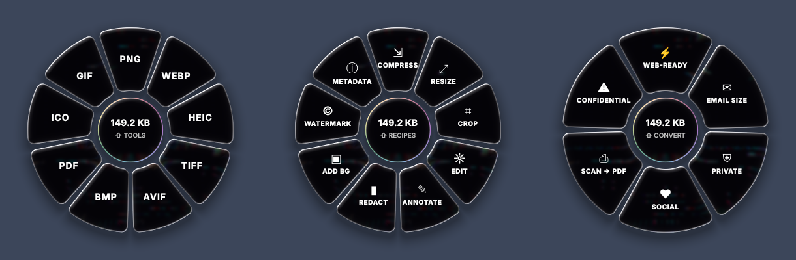
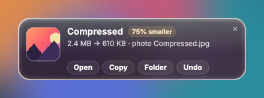
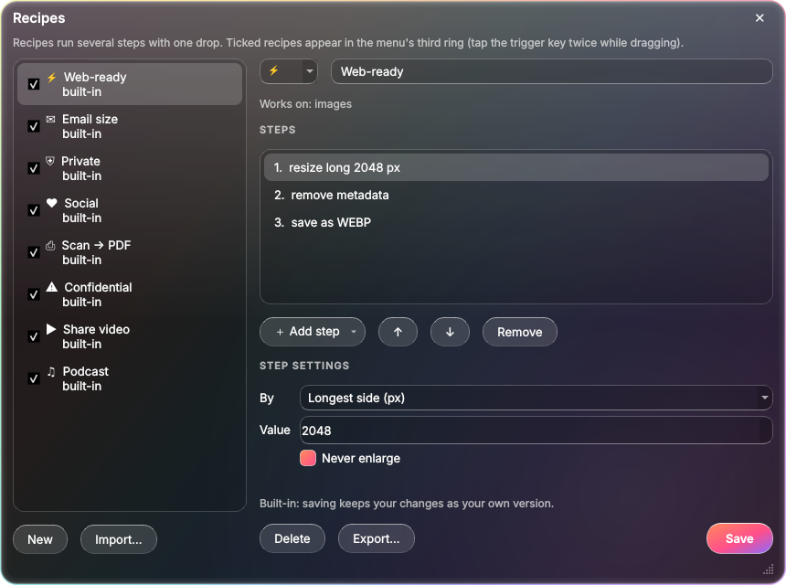
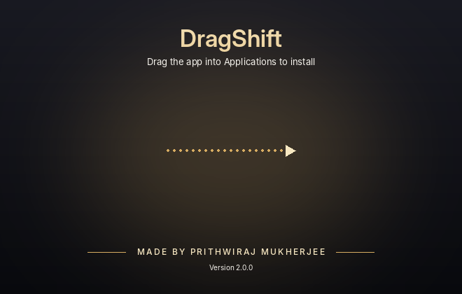

<p align="center">
  
</p>

<p align="center">
  <b>The fastest way to convert, compress and edit files.</b><br>
  No app to open, no upload, no waiting. Just drag, press Shift, and drop.
</p>

<p align="center">
  <a href="https://github.com/prithwirajmukherjee15-cmd/dragshift/releases/latest/download/DropDial-mac-apple-silicon.dmg"></a>
  <a href="https://github.com/prithwirajmukherjee15-cmd/dragshift/releases/latest/download/DropDial-mac-intel.dmg"></a>
  <br>
  <a href="https://github.com/prithwirajmukherjee15-cmd/dragshift/releases/latest/download/DropDial-Setup.exe"></a>
  <a href="https://github.com/prithwirajmukherjee15-cmd/dragshift/releases/latest/download/DropDial-linux-amd64.deb"></a>
</p>

<p align="center">
  <sub>Free · Works offline · Your originals are never touched · <a href="#install">Install help</a> · <a href="../../releases">All releases</a></sub>
</p>

<br>

<p align="center">
  
</p>

## How it works

<table>
  <tr>
    <td width="33%" valign="top"><h3>1 · Drag</h3>Start dragging any file, in Finder, File Explorer, your Linux file manager or on the desktop.</td>
    <td width="33%" valign="top"><h3>2 · Press Shift</h3>A glass dial opens right under your cursor, with only the options that fit that file.</td>
    <td width="33%" valign="top"><h3>3 · Drop</h3>Drop on a slice. The result appears next to the original, with a card showing what changed.</td>
  </tr>
</table>

Tap **Shift** again to flip between the three rings: **Convert**, **Tools** and **Recipes**.

<p align="center"></p>

## What it can do

<table>
  <tr>
    <td width="50%" valign="top">
      <h4>🖼️ Images</h4>
      Convert between JPG, PNG, WebP, HEIC, AVIF, TIFF, GIF, BMP, ICO and PDF. Compress to an exact size (“under 500 KB”), resize, crop, adjust light and colour, annotate, redact, add a gradient backdrop, watermark, and strip GPS and camera data.
    </td>
    <td width="50%" valign="top">
      <h4>📄 PDFs and documents</h4>
      PDF to images, Word or text; Word and text to PDF. Compress, split, merge, rotate, add page numbers, stamp a watermark, password-protect (AES-256), unlock, extract images, remove metadata.
    </td>
  </tr>
  <tr>
    <td valign="top">
      <h4>🎬 Video and audio</h4>
      MP4, MOV, MKV, WebM, AVI to MP4, WebM, MOV, MP3 or a smooth <b>GIF</b>. Compress videos, pull out the sound, mute, grab a frame, rotate. Convert audio between MP3, M4A, WAV, FLAC and OGG, even out loudness, trim silence.
    </td>
    <td valign="top">
      <h4>📚 SVG and e-books</h4>
      SVG to crisp PNG, JPG, WebP, ICO or vector PDF. EPUB, MOBI, FB2, XPS and CBZ to PDF (table of contents kept), Word or text.
    </td>
  </tr>
  <tr>
    <td valign="top">
      <h4>⚡ Recipes</h4>
      Several steps in a single drop. <i>Web-ready</i> resizes, strips metadata and saves as WebP; <i>Email size</i> shrinks photos, PDFs and videos to attach. Eight built in, and a builder for your own.
    </td>
    <td valign="top">
      <h4>📂 Watch folders</h4>
      Pick a folder and what should happen to new files in it: screenshots to WebP, scans to one PDF, downloads made private. It runs quietly in the background.
    </td>
  </tr>
  <tr>
    <td valign="top">
      <h4>🕘 History and undo</h4>
      Every result is listed, searchable, with Open, Show, Copy and Undo. Undo moves the new file to the Trash.
    </td>
    <td valign="top">
      <h4>⌨️ Command line</h4>
      Everything is scriptable too: <code>dropdial convert *.heic --to jpg</code>
    </td>
  </tr>
</table>

<p align="center"></p>

<details>
<summary><b>Every format and tool</b></summary>

<br>

| File | Convert to | Tools |
|---|---|---|
| **Images**: JPG, PNG, WEBP, HEIC, AVIF, TIFF, BMP, GIF, ICO | Any of those, or PDF. Several images become one PDF | Compress (by quality or to a target size, with a before/after preview) · Resize · Crop · Edit (auto, light, colour, rotate, flip, B&W) · Annotate (arrows, boxes, numbered steps, text, marker) · Redact · Add BG · Watermark · Metadata (view GPS, remove location only or everything) |
| **PDF** | JPG or PNG (one per page), DOCX, TXT | Compress · Split · Rotate · Merge (drop several) · Numbers · Watermark · Protect · Unlock · Extract images · Metadata |
| **Word** (.docx) | PDF (uses Microsoft Word when installed), TXT | |
| **Text** (.txt, .md, .csv…) | PDF, DOCX | |
| **Video**: MP4, MOV, MKV, WEBM, AVI, M4V… | MP4, WEBM, MOV, GIF (first 30 s), MP3 | Compress (H.264, up to 1080p) · Audio · Mute · Frame · Rotate |
| **Audio**: MP3, WAV, M4A, FLAC, OGG… | Any of those | Normalize (−16 LUFS) · Trim silence · Compress |
| **SVG** | PNG, JPG, WEBP (2048 px), PDF (vector), ICO | |
| **E-books**: EPUB, MOBI, FB2, XPS, CBZ | PDF, DOCX, TXT | |

</details>

<details>
<summary><b>Recipes</b></summary>

<br>

A step that doesn't fit a file is simply skipped for it, so one recipe can handle photos, PDFs and videos together.

| | Recipe | What it does | Works on |
|---|---|---|---|
| ⚡ | **Web-ready** | resize to 2048 px → remove metadata → WebP | images |
| ✉ | **Email size** | resize to 1600 px → photos under 900 KB, PDFs and videos compressed | images, PDFs, videos |
| ⛨ | **Private** | remove camera, GPS and author details | images, PDFs |
| ♥ | **Social** | gradient backdrop at 4:5 → 1350 px → JPG | images |
| ⎙ | **Scan → PDF** | auto-enhance → combine into one PDF → compress | images |
| ⚠ | **Confidential** | tiled CONFIDENTIAL watermark → page numbers | images, PDFs |
| ▶ | **Share video** | 720p MP4 that plays everywhere | videos |
| ♫ | **Podcast** | MP3 → trim silence → normalize loudness | videos, audio |

Open **Recipes…** from the menu-bar or tray icon to hide the ones you don't use, or build your own from 15 steps. Recipes are plain JSON files, so you can share them.

<p align="center"></p>

</details>

<details>
<summary><b>Command line</b></summary>

<br>

```bash
dropdial convert *.heic --to jpg
dropdial compress photo.jpg --target 500KB
dropdial resize *.png --long 1920 --out ~/Desktop/small
dropdial watermark *.jpg --text "© Your Name" --position tile
dropdial pdf merge a.pdf b.pdf          # also: split, rotate, number, protect, unlock, extract, compress
dropdial media gif clip.mov --fps 15    # also: audio, mute, frame, rotate, normalize, trim-silence
dropdial recipe run web-ready ~/Pictures/*.png
dropdial info photo.jpg video.mp4
dropdial watch ~/Screenshots --recipe web-ready   # Ctrl+C to stop
dropdial formats
```

Add `--json` for machine-readable output; the exit code is 1 if any file failed. From source, use `python -m dropdial` in place of `dropdial`.

</details>

## Install

<details open>
<summary><b>🍎 macOS</b> (macOS 11 or later)</summary>

<br>

**Easiest:** paste this into Terminal. It picks the right build for your Mac, installs it and opens it, with no security prompt. Run it again any time to update.

```bash
curl -fsSL https://raw.githubusercontent.com/prithwirajmukherjee15-cmd/dragshift/main/install-mac.sh | bash
```

**Or use the .dmg:** [Apple Silicon (M1–M4)](https://github.com/prithwirajmukherjee15-cmd/dragshift/releases/latest/download/DropDial-mac-apple-silicon.dmg) · [Intel](https://github.com/prithwirajmukherjee15-cmd/dragshift/releases/latest/download/DropDial-mac-intel.dmg). Open it and drag DropDial into Applications. DropDial lives in the menu bar.

<p align="center"></p>

The first time you open it, macOS may say it *“could not verify DropDial”*, because the app isn't notarized by Apple yet. Click **Done**, then go to **System Settings → Privacy & Security** and click **Open Anyway**. You only do this once. (Or run `xattr -dr com.apple.quarantine /Applications/DropDial.app`.)

Optional: allow **Screen Recording** when asked, so the glass can show the windows behind it. Nothing is ever recorded or sent anywhere.

</details>

<details>
<summary><b>🪟 Windows</b> (Windows 10 or 11)</summary>

<br>

[**DropDial-Setup.exe**](https://github.com/prithwirajmukherjee15-cmd/dragshift/releases/latest/download/DropDial-Setup.exe) installs for your user only (no admin rights) and adds a Start menu entry, *start with Windows*, a right-click **DropDial…** entry and **Send to → DropDial**. It uninstalls cleanly from Settings → Apps.

Prefer no installer? [**DropDial.exe**](https://github.com/prithwirajmukherjee15-cmd/dragshift/releases/latest/download/DropDial.exe) is portable: run it from anywhere.

If SmartScreen warns on first launch, click **More info → Run anyway**.

</details>

<details>
<summary><b>🐧 Linux</b> (Debian 12+, Ubuntu 23.04+, Mint, MX…)</summary>

<br>

Download [**DropDial-linux-amd64.deb**](https://github.com/prithwirajmukherjee15-cmd/dragshift/releases/latest/download/DropDial-linux-amd64.deb), then:

```bash
sudo apt install ./DropDial-linux-amd64.deb
```

Open DropDial from the app menu; it sits in the panel's notification area. It works in Thunar, Nautilus, Nemo, Caja, Dolphin and on the desktop, with or without a compositor, and adds **Open With → DropDial** to file menus.

The Shift-while-dragging trigger needs an X11 session (XFCE, MATE, Cinnamon, or “Ubuntu on Xorg”). On Wayland, right-click a file → **Open With → DropDial** works everywhere.

</details>

## Good to know

- **Private by design.** Everything runs on your computer. Files are never uploaded.
- **Originals are safe.** Results are saved next to the original (or in a `DropDial` subfolder, if you prefer). Nothing is ever overwritten.
- **Make it yours.** In Settings, choose the trigger key (Shift, Ctrl or Alt), where results go, JPG/WebP quality, PDF image resolution and start at login.
- **More ways in.** Right-click a file → **Open With → DropDial**, or click the menu-bar/tray icon to pick a file.

<details>
<summary><b>Build from source</b></summary>

<br>

```bash
pip install -r requirements.txt
python -m dropdial            # the app
python -m dropdial --help     # the command line
QT_QPA_PLATFORM=offscreen python -m pytest -q   # tests
```

On Linux, Qt also needs `sudo apt install libxcb-cursor0 libxkbcommon-x11-0`. Video and audio use ffmpeg from your PATH, or the copy bundled with `imageio-ffmpeg`. Every push is built and tested automatically on real Mac, Windows and Linux machines, including scripted drag-and-drop runs that check every output file.

</details>

<br>

<p align="center">
  <br>
  <b>DropDial</b><br>
  <sub>Made by Prithwiraj Mukherjee · <a href="LICENSE">MIT License</a></sub>
</p>
